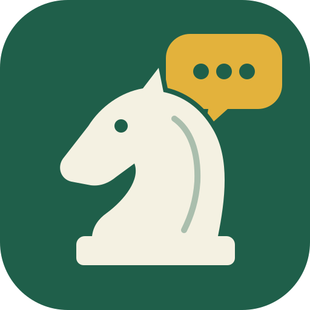

<p align="center">
  
</p>

<h1 align="center">Chess Coach</h1>

<p align="center">
  <a href="https://github.com/Sidney-Bishop/chess_coach/tags"></a>
  <a href="LICENSE"></a>
  <a href="https://github.com/Sidney-Bishop/chess_coach/commits/main"></a>
  
  
  
</p>

A chess tutor that runs in your browser. You play against the Stockfish engine,
and when one of your moves is worth talking about, a coach explains it in plain
words and can read it aloud. It is pitched at beginners rated about 500-600.

## How it works

- **The engine judges, the language model only explains.** Stockfish runs in
  the page and checks every move you make. When a move loses enough to matter,
  or punishes your opponent's mistake, the page works out the facts in code
  (what you missed, what the opponent can now take, who is ahead) and a
  language model turns them into one or two sentences.
- **It stays quiet on ordinary moves.** Mistakes, blunders and good replies are
  flagged; everything else gets no comment.
- **A short review at the end** sums up what came up in the game.
- **Optional voice.** Tick "Speak comments" and the browser reads each comment
  aloud, with chess notation turned into words ("knight takes E 4, check").
- **Move sounds.** Each move plays a short click, a heavier one for a capture
  and a chime for check. Untick "Move sounds" to turn them off.

## Run it

You need **Python 3** (only to serve the files) and a current browser such as
**Chrome**. There is nothing to install and no build step: the chess engine
runs inside the page.

**1. Get the code and start the page server.** In a terminal:

```bash
git clone https://github.com/Sidney-Bishop/chess_coach.git
cd chess_coach/web
python3 -m http.server 8080 --bind 127.0.0.1
```

On Windows, type `python` instead of `python3` if `python3` is not found.

**2. Open <http://localhost:8080/>** in the browser. The page must be opened
through this address: if you double-click `index.html` instead, the browser
will not start the chess engine.

**3. Play.** Leave the terminal open while you play. To stop, press
**Ctrl+C** in that terminal. Next time, only the last two commands are needed
(`cd chess_coach/web` and `python3 -m http.server ...`), run from the folder
you cloned into.

Without any further setup you can already play the engine at five levels,
with move sounds, take-backs and the scoresheet. The engine still flags your
mistakes and blunders, but with a short verdict instead of a written
explanation. For explanations, set up a coach model (next section).

To update to a newer version later: in the `chess_coach` folder run
`git pull`, then reload the page with **Cmd+Shift+R** (Mac) or
**Ctrl+Shift+R** (Windows and Linux) so the browser fetches the new files.

## Choose who writes the comments

Open **Coach model** in the Coach panel, pick one of the three options, fill
in its fields and press **Save and test**. The line next to the button says
whether the page could reach the model.

**Local model (oMLX)**, the default. Free, but only on an Apple Silicon Mac
(M1 or later). [oMLX](https://github.com/jundot/omlx) serves MLX models on your
Mac at `http://127.0.0.1:8000`. The page asks it for the two models named in
`web/config.js`; if you have different models, type their names into the
panel's two model fields instead (the names oMLX lists for them). Not on a Mac
with oMLX? Use one of the other two options.

**OpenAI-compatible service.** Three common ways to use it:

| You use | Address | API key | Model name |
|---|---|---|---|
| Ollama (free, runs on your computer: Mac, Windows or Linux) | `http://localhost:11434` | leave empty | a name from `ollama list`, for example `llama3.1` |
| LM Studio (free, runs on your computer) | `http://localhost:1234` | leave empty | the model identifier LM Studio shows for the loaded model |
| OpenAI (paid) | `https://api.openai.com` | your OpenAI key | a model name from your OpenAI account's model list |

For Ollama, install it from <https://ollama.com>, then download a model once
with `ollama pull llama3.1` (or any other model). For LM Studio, load a model,
start its local server, and switch on **Enable CORS** in the server settings,
otherwise the browser blocks the page from reaching it.

**Anthropic** (paid). Paste your Anthropic API key and a model name, as
listed in Anthropic's documentation.

For both of these options the review model field is optional: if it is empty,
the move model writes the end-of-game review too.

API keys are kept only in this browser's storage, never in the project's
files; anyone who uses the same browser profile can read them. Paid services
charge your account for each comment.

The OpenAI and Anthropic options have so far been tested only against stand-in
servers, not the real services. If one of them fails for you, please open an
issue on GitHub with the message shown next to **Save and test**.

**Spoken comments** need no setup: tick **Speak comments** and the browser
reads each comment aloud with a voice installed on your computer. Voices in
the "Online" group send the comment text to the voice's provider; the ones
under "On this computer" do not.

## If something goes wrong

- **"Address already in use" when starting the server.** Something else is
  using port 8080. Use another port, for example
  `python3 -m http.server 8081 --bind 127.0.0.1`, and open
  <http://localhost:8081/>.
- **The board appears but the engine never moves**, or the line under the
  scoresheet does not say "Engine: Stockfish 10, running in this page": the
  page was probably opened as a file. Open it through the
  `http://localhost:...` address instead.
- **The page looks out of date after `git pull`.** Reload with Cmd+Shift+R
  (Ctrl+Shift+R on Windows and Linux). The line under the scoresheet shows
  the build number, so you can check that the new version loaded.
- **Save and test cannot reach the model.** Check that the model server is
  running and the address is exactly as in the table above. For LM Studio,
  check that Enable CORS is on. For Ollama, if it is running but still cannot
  be reached, it may be refusing requests from the page; see "allowing
  additional web origins" in Ollama's FAQ (<https://docs.ollama.com/faq>).
  For a paid service, check the key and the model name.
- **No sound.** Click once anywhere on the page first: browsers play sound
  only after you have clicked. Check that **Move sounds** is ticked and that
  your computer is not muted.

## Documentation map

Durable knowledge lives in **`knowledge/`**, an OKF v0.2 bundle: a short root
index plus one file per concept. Read it in two steps — `knowledge/index.md`
first, then the one or two concepts whose descriptions match what you need. The
index says what each concept is *for*; it deliberately doesn't summarise
contents, because a summary there would rot.

| Location                        | Kind             | Read it for…                        | Update style           |
|---------------------------------|------------------|-------------------------------------|------------------------|
| `knowledge/index.md`            | Index            | **Start here.** What exists, and where | Update with concepts|
| `knowledge/overview.md`         | State            | What this is; current state          | Overwrite              |
| `knowledge/architecture.md`     | State            | How it's built right now             | Overwrite              |
| `knowledge/decisions/`          | Decision history | What we chose and why (D-IDs)        | New file + supersede   |
| `knowledge/open-questions/`     | State + history  | What we don't know yet (Q-IDs)       | New file; close, don't delete |
| `knowledge/pitfalls.md`         | Invariants       | What fails quietly when broken       | Append entries         |
| `knowledge/conventions.md`      | Reference        | How to add to the bundle; how we work| Overwrite              |
| `knowledge/log.md`              | History          | What changed in the knowledge, dated | Append-only            |
| `docs/journal.md`               | Session history  | The road: what happened, what broke  | Append-only, dated     |

`docs/decisions.md` and `docs/open_questions.md` are **signposts** pointing into
the bundle — they hold no records. Don't append to them.

**Routing rule** — where does a sentence go? `true now` → `overview.md` or
`architecture.md` · `a choice someone will later question` → a new D-ID concept ·
`something we don't know yet` → a new Q-ID concept · `something that happened` →
`docs/journal.md` · `a constraint that fails quietly` → `pitfalls.md`.

## Layout

```
chess_coach/
├── web/            # the page: index.html, coach.js, config.js, vendor/
├── scripts/        # make_artifact.py, prompt_trial.py
├── knowledge/      # the knowledge bundle above
├── docs/           # journal and signposts
└── src/            # Python package from the scaffold (unused by the page)
```

Work happens on `feature/<name>` branches off `develop`; `main` receives only
tagged releases (decision D008).

## Licence

Chess Coach is free software, licensed under the GNU General Public License,
version 3 or (at your option) any later version. See [LICENSE](LICENSE).

It includes third-party code in `web/vendor/`, listed with versions and
checksums in `web/vendor/VENDORED.txt`:

- [Stockfish](https://stockfishchess.org/) 10 (via the `stockfish` npm package
  10.0.2), GPL-3.0;
- [chess.js](https://github.com/jhlywa/chess.js) 0.10.3, BSD-2-Clause.
